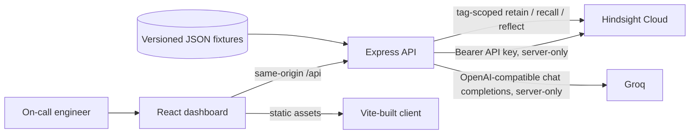

# Recall — AI On-Call Memory

Recall is a dark incident-response workspace that lets on-call engineers compare a live incident with real Hindsight memories and ask Groq for a cautious recommendation. It never executes remediation. Hindsight is the only long-term memory; this project deliberately has no managed database or custom vector store.

> **Recommendations only. Recall never executes actions.**

## Architecture

In development, Vite listens on port `3000` and proxies `/api/*` and `/_app/health` to Express on port `3001`. In production, publish the static client directory `dist/client` and the Node API container separately; route health and `/api/*` to the container before the static asset and SPA rules. Browser requests remain same-origin and relative.

## Setup

1. Use Node.js 22 and npm `10.9.2` (pinned in `package.json`). Run `npm install`.
2. Configure the four server-only values using the protected Manus project-secret UI, or copy `.env.example` to an ignored `.env` for a local environment:
   - `HINDSIGHT_API_KEY` — private Hindsight Cloud API key.
   - `HINDSIGHT_BASE_URL` — Hindsight API base URL; the documented Cloud default is `https://api.hindsight.vectorize.io`.
   - `HINDSIGHT_BANK_ID` — the Hindsight memory bank used by this Recall instance.
   - `GROQ_API_KEY` — private Groq API key.
3. Start the Vite client and Express API together with `npm run dev`.
4. In a development instance, `POST /api/admin/seed` retains the 18 checked-in incident histories in Hindsight. The seed uses stable `recall-app-<incident-id>` document IDs and the `recall-app-v1` tag.
   Hindsight's documented retain upsert replaces an existing document with the same ID, so rerunning seed updates rather than duplicates each seeded history.
5. Build with `npm run build:client` and `npm run build:server`; start the API container with `npm start`.

The Hindsight and Groq credentials are read only by server code. They are never included in `VITE_*` settings, client bundles, API responses, or logs. `.gitignore` excludes `.env` and other real environment files while allowing `.env.example`.

## How Hindsight memory is used

Past incident fixtures are converted to structured natural-language narratives containing the incident identifier, timestamp, service, symptom and metric pattern, hypotheses, failed fixes, confirmed root cause, resolution, outcome, deploy version, and—where present—the engineer correction. Raw JSON dumps and raw log excerpts are not retained as memory.

Recall adds the `recall-app-v1` tag to its memories and uses Hindsight's strict tag filter for recall and Reflect. This isolates Recall's own seeded/feedback memories from other untagged content that may already exist in the chosen bank. An empty recall stays empty: the UI displays “No comparable past incident found” and does not fabricate a match. Incidents older than six months receive a ranking penalty and an “Older incident” badge. Resolved outcomes can raise confidence; recurred outcomes can lower it. Engineer corrections supersede early beliefs.

Before a recalled memory is sent to Groq, Recall carries forward correction and failed-fix metadata returned by Hindsight alongside its text, so provider summaries cannot silently discard the lesson.

`Worked`, `Didn’t work`, and `Wrong because…` are retained as timestamped Hindsight memories with an incident/service link. Corrections are explicitly marked as superseding the prior belief. The timeline is based on actual Hindsight recalls.

**Reset is intentionally bank-wide.** `POST /api/admin/reset` invokes Hindsight's documented delete-all-memories endpoint for the configured bank. The demo UI explains this and requires an explicit confirmation before calling it; it can remove memories in that bank that were not created by Recall. No reset runs during project setup. The API has no authentication because this is the requested scope; do not expose an unauthenticated Preview publicly without reviewing that decision.

The **Reset & replay demo** is a separate user-triggered, five-step flow: after the explicit bank-wide confirmation, it clears the bank, upserts 18 histories without the INC-0831 correction, runs a live memory-off analysis for INC-0902, retains the fixture's engineer correction through the historical-feedback route, then runs a live Hindsight/Groq memory-on analysis. Each phase reports provider-confirmed progress and stops on the first failure. The two real returned analyses are shown together; no “improved” answer is fabricated if Hindsight does not surface a citation. The sequence is not run during setup.

## Models and evaluation

Groq analysis requests use `openai/gpt-oss-120b`. Malformed JSON or function/tool-call output is retried up to three times before the requested fallback identifier `qwen/qwen3-32b` is attempted. Model/API errors are returned as readable UI errors. If Groq does not support the requested fallback identifier for the account, Recall reports that provider response rather than silently substituting a different model.

The Evaluation screen's eight test cases are held out from Hindsight seed memory. Each run makes real memory-off and memory-on analysis requests; truth labels are kept server-side and are not sent to the model. Chart values and table scores are computed from completed model responses, never preset or reused. If a required provider call fails, the run shows an error instead of fabricated accuracy.

## API routes

| Method | Route | Purpose |
|---|---|---|
| GET | `/api/incidents/active` | List the three active incident fixtures. |
| GET | `/api/incidents/history` | List historical incidents available in the timeline selector. |
| GET | `/api/incidents/:id` | Read an active or historical incident fixture. |
| POST | `/api/incidents/:id/analyze` | Run Groq analysis with Hindsight memory on or off. |
| POST | `/api/incidents/:id/feedback` | Retain success/failed-fix feedback for an incident or an engineer correction linked to a historical incident. |
| GET | `/api/memory/timeline/:incidentId` | Retrieve the belief/correction timeline from Hindsight. |
| POST | `/api/compare/:id` | Analyze once without memory and once with real Hindsight recall. |
| POST | `/api/admin/seed` | Retain all 18 historical incident narratives. |
| POST | `/api/admin/reset` | Clear all memories in the configured Hindsight bank after UI confirmation. |
| POST | `/api/eval/run` | Run eight held-out cases through both live analysis modes and compute accuracy. |
| GET | `/_app/health` | Unauthenticated application health check. |

## Safety and validation

`redact()` removes API keys, token/password/authorization values, emails, IPv4 addresses, and IPv6 addresses before log text or user feedback is retained or sent to an LLM. The checked-in historical log snippets contain no credentials. All incident/evaluation API responses use `Cache-Control: private, no-store`. No authentication is implemented, as requested. No app database, vector store, or fake Hindsight provider is included.

The only unit-test file is the requested `tests/redact.test.ts`, covering `redact()` only.

## Provider references

- [Hindsight API reference](https://hindsight.vectorize.io/api-reference) — bearer authentication, retain/recall/Reflect/delete routes, strict tag matching, and request/response schemas.
- [Hindsight Cloud quickstart](https://hindsight.vectorize.io/developer/api/quickstart) — Cloud API base URL and first retain/recall request.
- [Hindsight retain API](https://hindsight.vectorize.io/developer/api/retain)
- [Hindsight recall API](https://hindsight.vectorize.io/developer/api/recall)
- [Hindsight Reflect API](https://hindsight.vectorize.io/developer/api/reflect)
- [Groq OpenAI compatibility](https://console.groq.com/docs/openai)
- [Groq structured outputs](https://console.groq.com/docs/structured-outputs)
- [Groq model catalog](https://console.groq.com/docs/models)
